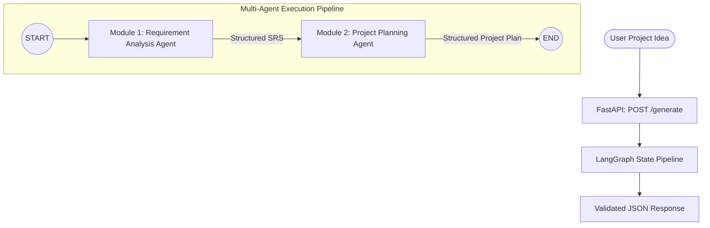

# AI-Driven Software Engineering Blueprint Generator

A research-oriented multi-agent AI system designed to convert natural-language software project ideas into structured, high-traceability Software Engineering Blueprints.

---

## 1. Project Overview

Transforming a vague, informal software requirement into an executable engineering blueprint is a core challenge in software engineering. This project introduces an autonomous multi-agent pipeline using **LangGraph**, **LangChain**, **Pydantic**, and local **Ollama LLMs** (`Qwen 2.5 3B`) to perform systematic requirement elicitation, stakeholder modeling, ambiguity identification, modular breakdown, task dependency scheduling, and roadmap generation.

---

## 2. Architecture & Pipeline

The system is orchestrated using a deterministic state machine powered by **LangGraph**:



### Traceability Model
A core research capability is **Requirement Traceability**:
$$\text{Stakeholder} \rightarrow \text{Functional Requirement (FR-xxx)} \rightarrow \text{Module (MOD-xxx)} \rightarrow \text{Task (T-xxx)} \rightarrow \text{Milestone (M-xxx)}$$
Every engineering task retains explicit mappings to the functional requirements it implements.

---

## 3. Technology Stack

- **Core Framework**: Python 3.11+
- **API Engine**: FastAPI + Uvicorn
- **Orchestration**: LangGraph
- **LLM Integration**: LangChain + LangChain-Ollama
- **Data Validation & Schemas**: Pydantic v2 + Pydantic Settings
- **Configuration**: python-dotenv
- **Local Inference Engine**: Ollama (`qwen2.5:3b`)
- **Testing**: Pytest

> **Privacy & Offline First**: Runs 100% locally. Does not require external cloud API keys (No OpenAI, Gemini, Groq, or Anthropic keys needed).

---

## 4. Current Implementation Scope

| Scope | Status | Description |
|---|---|---|
| **Module 1: Requirement Analysis Agent** | **Implemented** | Extracts Stakeholders (`ST-xxx`), Functional Requirements (`FR-xxx`), Non-Functional Requirements (`NFR-xxx`), Constraints, Ambiguities, and Assumptions into a structured SRS. |
| **Module 2: Project Planning Agent** | **Implemented** | Consumes structured SRS from Module 1 to produce Modules (`MOD-xxx`), Tasks (`T-xxx`), Task Dependency DAGs, Milestones (`M-xxx`), and Phased Roadmaps. |
| **LangGraph Orchestration** | **Implemented** | Shared typed state pipeline (`BlueprintState`) connecting Module 1 $\rightarrow$ Module 2. |
| **Interactive Web UI Dashboard** | **Implemented** | Glassmorphism dark-mode UI with demo chips, MoSCoW filter, traceability table, and Markdown/JSON export. |
| **FastAPI REST Service** | **Implemented** | `/`, `/health`, and `/generate` endpoints with Pydantic validation and error handling. |


### Future Modules (Roadmap)
- **Module 3: Architecture Design Agent** — System topology, C4 model diagrams, API specifications, and database schema synthesis.
- **Module 4: Knowledge Retrieval / RAG Module** — Architecture pattern lookup and best-practice grounding.
- **Module 5: Validation & Iterative Refinement Agent** — Consistency verification, circular-dependency resolution, and requirement-coverage audits.

---

## 5. Installation & Setup

### Prerequisites
1. **Python 3.11+**
2. **Ollama**: Download and install from [ollama.com](https://ollama.com).

### Step 1: Clone and Set Up Virtual Environment
```bash
git clone <repository_url>
cd software-blueprint-ai

python -m venv .venv
# On Windows:
.venv\Scripts\activate
# On Linux/macOS:
source .venv/bin/activate
```

### Step 2: Install Python Dependencies
```bash
pip install -r requirements.txt
```

### Step 3: Set Up Ollama & Pull Model
Ensure Ollama is running, then pull the `qwen2.5:3b` model:
```bash
ollama pull qwen2.5:3b
```

### Step 4: Environment Configuration
Copy `.env.example` to `.env`:
```bash
copy .env.example .env   # Windows
# or
cp .env.example .env     # Linux/macOS
```
Default `.env` configuration:
```ini
OLLAMA_BASE_URL=http://localhost:11434
OLLAMA_MODEL=qwen2.5:3b
OLLAMA_TEMPERATURE=0.0
```

---

## 6. How to Run

### Start the FastAPI Server
```bash
uvicorn app.main:app --host 0.0.0.0 --port 8000 --reload
```
Interactive API docs will be available at:
- **Swagger UI**: [http://localhost:8000/docs](http://localhost:8000/docs)
- **ReDoc**: [http://localhost:8000/redoc](http://localhost:8000/redoc)

---

## 7. Running Tests

Run the complete automated test suite (15 unit and integration tests):
```bash
pytest tests/ -v
```

---

## 8. API Documentation

### 1. Health Check
- **Method**: `GET`
- **Path**: `/health`
- **Response**:
```json
{
  "status": "ok"
}
```

### 2. Generate Blueprint
- **Method**: `POST`
- **Path**: `/generate`
- **Request Body**:
```json
{
  "project_idea": "Build an online food delivery platform for customers, restaurants and delivery partners."
}
```

---

## 9. Example Request & Response

### Request:
```bash
curl -X POST "http://localhost:8000/generate" \
     -H "Content-Type: application/json" \
     -d "{\"project_idea\": \"Build an online food delivery platform for customers, restaurants and delivery partners.\"}"
```

### Response (Conceptual Structure):
```json
{
  "requirements": {
    "project_name": "Online Food Delivery Platform",
    "project_description": "A comprehensive multi-sided platform enabling customers to order food, restaurants to manage menus, and delivery partners to fulfill orders.",
    "stakeholders": [
      {
        "id": "ST-001",
        "name": "Customer",
        "description": "End-user browsing menus, placing orders, and tracking deliveries."
      },
      {
        "id": "ST-002",
        "name": "Restaurant",
        "description": "Food merchant managing menus, orders, and food preparation."
      },
      {
        "id": "ST-003",
        "name": "Delivery Partner",
        "description": "Logistics agent responsible for picking up and delivering orders."
      }
    ],
    "functional_requirements": [
      {
        "id": "FR-001",
        "title": "User Authentication and Profile Management",
        "description": "The system shall allow customers, restaurants, and drivers to register and authenticate securely.",
        "priority": "Must",
        "stakeholders": ["ST-001", "ST-002", "ST-003"]
      },
      {
        "id": "FR-002",
        "title": "Restaurant Catalog and Menu Search",
        "description": "Customers shall be able to search restaurants, filter by cuisine, and view dish menus.",
        "priority": "Must",
        "stakeholders": ["ST-001", "ST-002"]
      },
      {
        "id": "FR-003",
        "title": "Order Placement and Checkout",
        "description": "Customers shall be able to add items to cart, select delivery address, and place an order.",
        "priority": "Must",
        "stakeholders": ["ST-001"]
      }
    ],
    "non_functional_requirements": [
      {
        "id": "NFR-001",
        "category": "Security",
        "description": "User credentials and authentication tokens must be securely stored and encrypted at rest.",
        "priority": "Must"
      },
      {
        "id": "NFR-002",
        "category": "Performance",
        "description": "Menu searches and order status queries must respond within 500ms under standard load.",
        "priority": "Must"
      }
    ],
    "constraints": [
      "Must run on local hardware without external cloud LLM dependencies.",
      "Must support web and mobile responsive interfaces."
    ],
    "ambiguities": [
      {
        "ambiguity": "Delivery radius and routing mechanism is not specified.",
        "possible_clarification": "What maximum delivery radius should be enforced per restaurant?"
      }
    ],
    "assumptions": [
      "Users and delivery partners have internet-connected devices with GPS capabilities."
    ]
  },
  "project_plan": {
    "modules": [
      {
        "id": "MOD-001",
        "name": "Authentication & Authorization",
        "description": "Handles user credentials, JWT tokens, and role-based permissions.",
        "requirement_ids": ["FR-001"],
        "task_ids": ["T-001", "T-002"]
      },
      {
        "id": "MOD-002",
        "name": "Menu & Catalog Management",
        "description": "Restaurant onboarding, menu creation, and catalog search.",
        "requirement_ids": ["FR-002"],
        "task_ids": ["T-003"]
      },
      {
        "id": "MOD-003",
        "name": "Order Management & Checkout",
        "description": "Cart management, order processing, and payment status tracking.",
        "requirement_ids": ["FR-003"],
        "task_ids": ["T-004"]
      }
    ],
    "tasks": [
      {
        "id": "T-001",
        "title": "Design Database Schema for User Roles",
        "description": "Implement database tables and models for customers, restaurants, and drivers.",
        "requirement_ids": ["FR-001"],
        "priority": "Must",
        "estimated_hours": 4.0,
        "dependencies": []
      },
      {
        "id": "T-002",
        "title": "Implement JWT Authentication Endpoints",
        "description": "Build registration, login, and token refresh endpoints with bcrypt password hashing.",
        "requirement_ids": ["FR-001"],
        "priority": "Must",
        "estimated_hours": 6.0,
        "dependencies": ["T-001"]
      },
      {
        "id": "T-003",
        "title": "Build Restaurant Menu Catalog API",
        "description": "Create CRUD endpoints for menu items and search filters.",
        "requirement_ids": ["FR-002"],
        "priority": "Must",
        "estimated_hours": 8.0,
        "dependencies": ["T-001"]
      },
      {
        "id": "T-004",
        "title": "Develop Order Processing Pipeline",
        "description": "Implement cart checkout, order state transitions, and notification dispatch.",
        "requirement_ids": ["FR-003"],
        "priority": "Must",
        "estimated_hours": 10.0,
        "dependencies": ["T-002", "T-003"]
      }
    ],
    "milestones": [
      {
        "id": "M-001",
        "name": "Foundation & Authentication",
        "description": "Core data models and authentication infrastructure completed.",
        "task_ids": ["T-001", "T-002"]
      },
      {
        "id": "M-002",
        "name": "Catalog & Order Management",
        "description": "Menu browsing and complete order placement flow functional.",
        "task_ids": ["T-003", "T-004"]
      }
    ],
    "roadmap": [
      "Phase 1: Architecture & Foundation Setup",
      "Phase 2: Authentication & User Management",
      "Phase 3: Catalog & Order Services",
      "Phase 4: Integration & System Testing"
    ]
  }
}
```

---

## 10. Project Directory Structure

```
software-blueprint-ai/
│
├── app/
│   ├── __init__.py
│   ├── main.py                  # FastAPI application & HTTP endpoints
│   ├── graph.py                 # LangGraph orchestration state machine
│   ├── state.py                 # Typed state definitions (BlueprintState)
│   ├── llm.py                   # Ollama client & resilient structured output invocation
│   ├── schemas.py               # Pydantic models & validation rules
│   │
│   ├── static/                  # Interactive Frontend Web UI
│   │   ├── index.html           # Single-page dashboard interface
│   │   ├── style.css            # Dark mode glassmorphism styles
│   │   └── app.js               # Dynamic tab & blueprint rendering logic
│   │
│   └── agents/
│       ├── __init__.py
│       ├── requirement_agent.py # Module 1: SRS generator
│       └── planning_agent.py    # Module 2: Engineering planner
│
├── tests/
│   ├── __init__.py
│   ├── test_requirement_agent.py # Module 1 unit tests
│   ├── test_planning_agent.py    # Module 2 unit tests
│   └── test_workflow.py          # Pipeline & FastAPI integration tests
│
├── .env
├── .env.example
├── .gitignore
├── requirements.txt
└── README.md

```
